# Jenkins–Docker–AWS CI/CD Pipeline with Automated Rollback

## Project Overview

This project demonstrates an end-to-end CI/CD pipeline using Jenkins, Docker, GitHub, Amazon ECR, Amazon EC2, and AWS Systems Manager (SSM).

The pipeline automates Docker image building, image publishing to Amazon ECR, and application deployment to an AWS EC2 instance.

The project also includes deployment health checks, failure detection, manual rollback, and automatic rollback to restore the previous working application when a deployment fails.

## Technologies Used

| Technology | Purpose |
|---|---|
| Jenkins | CI/CD pipeline automation |
| Git and GitHub | Source code management |
| Docker | Application containerization |
| Amazon ECR | Docker image registry |
| Amazon EC2 | Application hosting |
| AWS Systems Manager (SSM) | Remote deployment and instance management |
| AWS IAM | Access control and permissions |
| Bash | Deployment and rollback automation |
| Nginx | Web server |

## CI/CD Architecture

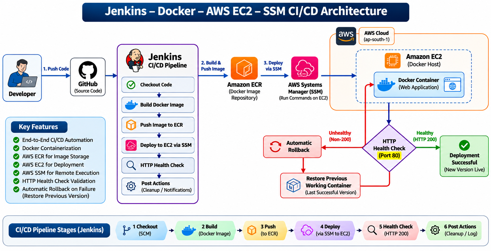


## CI/CD Pipeline Workflow

1. Jenkins retrieves the application source code from GitHub.
2. Jenkins builds a Docker image containing the Nginx web application.
3. The Docker image is tagged for deployment.
4. Jenkins pushes the Docker image to Amazon ECR.
5. The deployment process runs on AWS EC2 using AWS Systems Manager.
6. The existing application container is preserved as a backup.
7. A new Docker container is started using the updated image.
8. HTTP health checks verify whether the application is responding.
9. If the deployment fails, the rollback mechanism restores the previous working container.

## Project Structure

```text
devops-cicd-practice/
|
|-- Jenkinsfile
|-- Dockerfile
|-- index.html
|-- scripts/
|   |-- deploy-aws.sh
|
|-- README.md
```

## Docker Containerization

The application is containerized using Docker and served through Nginx.

Docker provides a consistent environment for building and deploying the application.

The Docker image is stored in Amazon ECR and deployed to AWS EC2.

## AWS Infrastructure

### Amazon EC2

An EC2 instance hosts the containerized web application.

Docker runs the application inside a container, exposing the website through HTTP port 80.

### Amazon ECR

Amazon Elastic Container Registry stores the Docker images generated by the Jenkins pipeline.

Deployment images are tagged to identify different application builds.

### AWS Systems Manager

AWS Systems Manager is used to manage the EC2 instance and execute deployment operations.

### AWS IAM

IAM permissions are configured to control access to AWS resources required for the CI/CD workflow.

## Automated Deployment

The deployment automation is implemented in:

`scripts/deploy-aws.sh`

The deployment process includes:

- Docker image deployment
- Previous-container backup
- Application health verification
- Deployment failure detection
- Automatic rollback
- Recovery of the previous working application

## Deployment Health Checks

After deployment, the application is checked using HTTP requests.

A successful HTTP response confirms that the website is responding.

If the new deployment fails its health checks, the deployment process triggers automatic rollback.

## Manual Rollback Testing

Manual rollback was tested to verify that a previous working deployment could be restored.

**Test Result: PASSED**

The previous application deployment was successfully restored.

## Automatic Rollback Testing

Automatic rollback was tested using a deliberately broken Docker image in an isolated test environment.

### Test Procedure

1. Started with a healthy application container.
2. Attempted deployment using a deliberately broken Docker image.
3. Confirmed that the new deployment failed its health check.
4. Verified that the rollback mechanism restored the previous working container.
5. Checked the restored application using an HTTP request.

### Test Results

The rollback script displayed:

```text
SUCCESS: Previous AWS deployment restored.
```

The restored application returned:

```text
HTTP 200
```

**Test Result: PASSED**

The automatic rollback mechanism successfully recovered the previous working application.

## Project Verification Results

| Test | Result |
|---|---|
| Jenkins pipeline execution | PASSED |
| Docker image build | PASSED |
| Docker image publishing to Amazon ECR | PASSED |
| AWS EC2 application deployment | PASSED |
| Production application health check | PASSED - HTTP 200 |
| Manual rollback testing | PASSED |
| Automatic rollback testing | PASSED |
| Restored application health check | PASSED - HTTP 200 |

## Project Screenshots

### 1. Docker Image Build

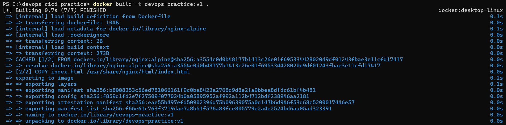

### 2. Jenkins CI/CD Pipeline Success

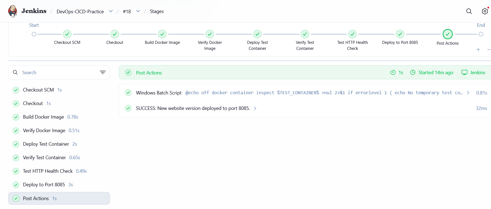

### 3. Jenkins Automatic Rollback

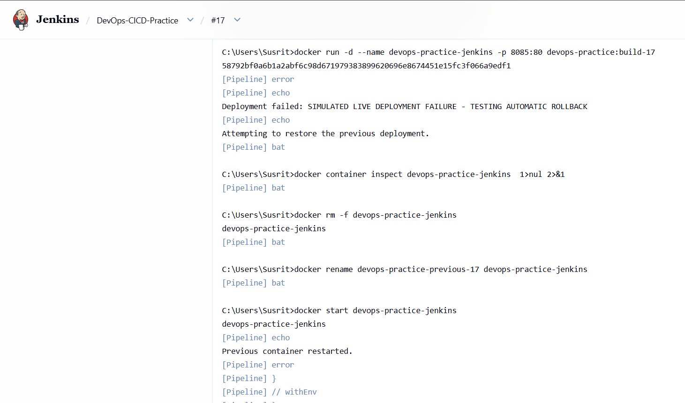

### 4. AWS IAM Role for SSM

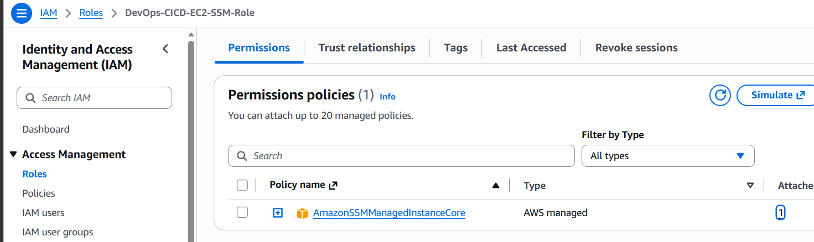

### 5. AWS EC2 Instance Running

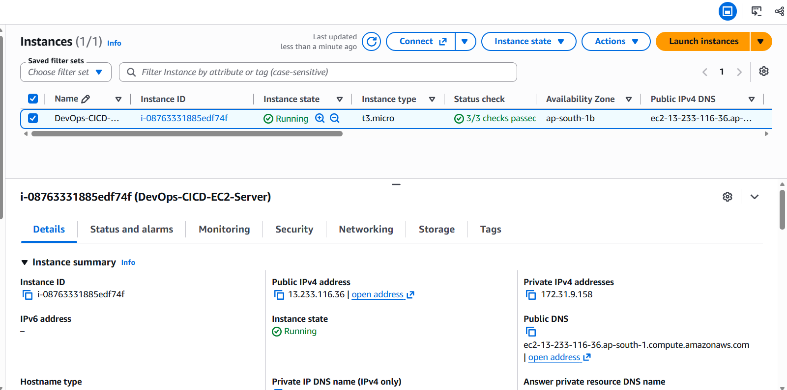

### 6. Docker Image Pushed to AWS ECR

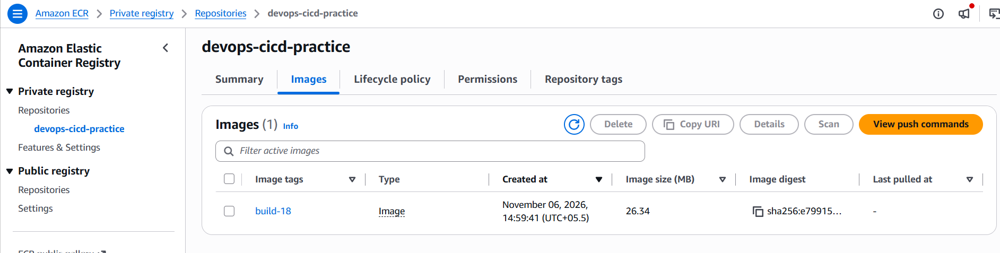

### 7. AWS SSM Command Execution

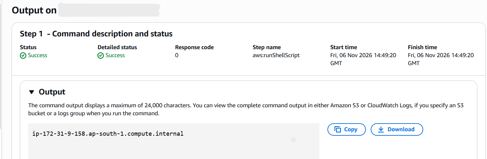

### 8. Successful AWS EC2 Deployment

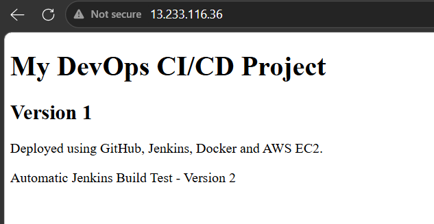

### 9. Successful Manual AWS Rollback

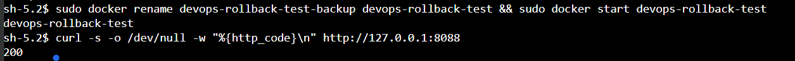

### 10. Successful Automatic AWS Rollback

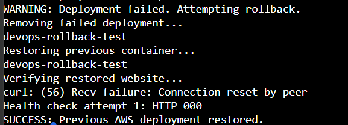

## Key Learning Outcomes

Through this project, I gained practical experience in:

- Building Jenkins CI/CD pipelines
- Managing application source code using Git and GitHub
- Creating and managing Docker containers
- Publishing Docker images to Amazon ECR
- Deploying applications on AWS EC2
- Using AWS Systems Manager
- Configuring AWS IAM permissions
- Writing Bash deployment scripts
- Implementing deployment health checks
- Handling deployment failures
- Testing manual and automatic rollback procedures

## Future Improvements

- Integrate automated application testing
- Add container image security scanning
- Configure HTTPS for the deployed website
- Implement deployment monitoring and notifications

## Author

**Susrit Sahu**

GitHub: [susritsahu-personal](https://github.com/susritsahu-personal)
